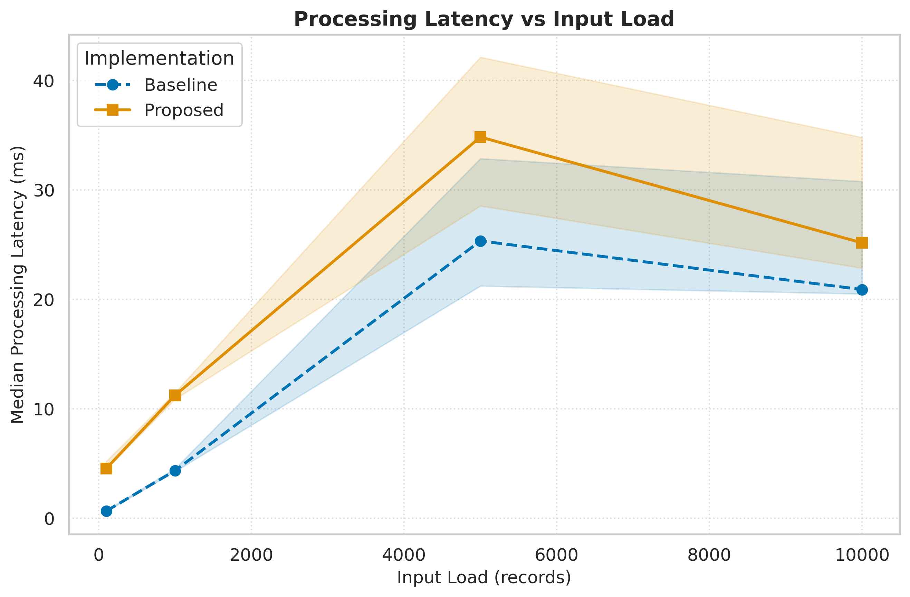
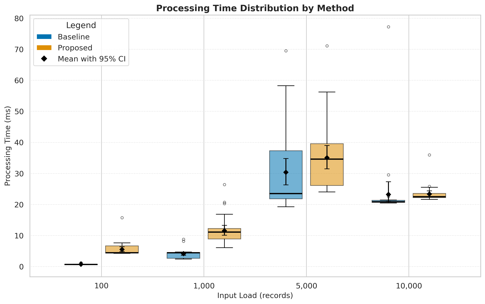

# Human Ability to Detect AI-Generated Phishing Emails: A Review of Existing Research

## 1. Project Overview

This research examines human ability to identify phishing emails in the context of generative artificial intelligence.

The project combines a review of existing cybersecurity research with a quantitative student survey and a separate technical performance benchmark of the Python data-processing pipeline.

The empirical survey examines how students distinguish six AI-generated phishing messages from six AI-generated legitimate-style messages. All twelve stimuli were created using ChatGPT; no human-written comparison group was included.

The technical benchmark evaluates the execution performance of two data-processing implementations under different synthetic workloads.

**Authors:** Zhadyra Kurmanova and Meirim Yersultan  
**Institution:** Narxoz University  
**Research Area:** Cybersecurity

## 2. Research Objectives

1. Review existing research on human phishing detection.
2. Examine how accurately students identify AI-generated phishing emails.
3. Compare detection recall across the six AI-generated phishing examples.
4. Explore the relationship between self-reported cybersecurity knowledge and phishing detection performance.
5. Identify the indicators participants primarily use when evaluating suspicious emails.
6. Evaluate the performance of the research data-processing pipeline.

## 3. Research Questions

- **RQ1:** How accurately can university students identify AI-generated phishing emails?
- **RQ2:** How does detection recall vary across the six AI-generated phishing examples?
- **RQ3:** How are self-reported cybersecurity knowledge and previous phishing experience related to phishing detection performance?
- **RQ4:** Which indicators do participants primarily rely on when identifying phishing emails?

See [Research Questions](docs/research_questions.md).

## 4. Survey Design

The questionnaire contains 12 email examples:

| Email category | Number of examples |
|---|---:|
| AI-generated phishing | 6 |
| AI-generated legitimate-style | 6 |
| **Total** | **12** |

The survey collects age group, self-reported cybersecurity knowledge, previous phishing experience, email classifications, first detection indicator, and confidence.

All twelve email examples were generated using ChatGPT. The phishing examples are emails 01, 03, 05, 07, 09, and 11; the legitimate-style examples are emails 02, 04, 06, 08, 10, and 12. The legitimate-style messages are simulated examples, not independently collected real correspondence.

The original participant-level survey export is kept private. Only approved aggregate research results may be published.

See:

- [Research Methodology](docs/methodology.md)
- [Email Stimuli](docs/email_stimuli.md)
- [Data Dictionary](docs/data_dictionary.md)

## 5. Student Survey Results

The study included 27 participants who classified 12 email examples, producing 324 classifications.

The analysis used the documented answer key with six AI-generated phishing emails and six AI-generated legitimate-style emails.

| Metric | Result |
|---|---:|
| Participants | 27 |
| Total classifications | 324 |
| Overall accuracy | 79.3% |
| Phishing recall | 85.2% |
| Phishing precision | 76.2% |
| Legitimate-style specificity | 73.5% |
| False positive rate | 26.5% |
| F1-score | 80.5% |

Recall across individual phishing examples ranged from 77.8% to 92.6%. Because all stimuli were AI-generated, this survey cannot compare AI-written and human-written phishing messages.

The results are based on the documented email answer key and the anonymized survey responses.

See the [Research Paper](docs/paper_draft.md) and [PDF Version](docs/paper_draft_f.pdf).

Survey figures (PNG and PDF) are available in `reports/figures/`:

- [Classification accuracy by email](reports/figures/survey_accuracy_by_email.png)
- [Recall across six phishing emails (95% CI)](reports/figures/survey_phishing_email_recall.png)
- [Confusion matrix](reports/figures/survey_confusion_matrix.png)
- [Cybersecurity knowledge](reports/figures/survey_cyber_knowledge.png)
- [Previous phishing experience](reports/figures/survey_phishing_experience.png)
- [First detection indicator](reports/figures/survey_first_indicator.png)

Aggregate tables are in `data/processed/`, including `phishing_email_metrics.csv` and `survey_classification_confidence_intervals.csv`.

## 6. Technical Performance Benchmark

A separate benchmark evaluates two implementations of the same data-processing task:

- **Baseline:** Python loop-based implementation.
- **Proposed:** Pandas vectorized implementation.

Both implementations process the same synthetic classification workload and are validated to produce equivalent analytical results.

### 6.1. Experimental Configuration

| Parameter | Value |
|---|---:|
| Methods | 2 |
| Input sizes | 100, 1,000, 5,000, 10,000 records |
| Warm-up runs per method and load | 5 |
| Evaluation runs per method and load | 30 |
| Total warm-up runs | 40 |
| Total evaluation runs | 240 |
| Total measurements | 280 |
| Bootstrap iterations | 5,000 |
| Confidence level | 95% |
| Random seed | 42 |

**Benchmark environment:** Python 3.13.18, Linux x86_64, 2 logical CPUs, Pandas 2.2.3, NumPy 2.4.6. The processor was reported as x86_64; a specific CPU model was not recorded.

### 6.2. Results and Discussion

The benchmark compares processing latency under four input sizes.

Mean and standard deviation are reported alongside median and interquartile range. All latency measurements are expressed in milliseconds.

| Method | Load (records) | Mean ± SD (ms) | Median (p25–p75) (ms) |
|---|---:|---:|---:|
| Baseline | 100 | 0.741 ± 0.185 | 0.690 (0.613–0.726) |
| Proposed | 100 | 5.512 ± 2.280 | 4.446 (4.375–6.671) |
| Baseline | 1,000 | 4.161 ± 1.486 | 4.439 (2.651–4.546) |
| Proposed | 1,000 | 11.566 ± 4.688 | 11.110 (8.900–12.269) |
| Baseline | 5,000 | 30.378 ± 12.439 | 23.506 (21.845–37.349) |
| Proposed | 5,000 | 35.063 ± 10.566 | 34.620 (26.136–39.585) |
| Baseline | 10,000 | 23.258 ± 10.336 | 20.876 (20.689–21.348) |
| Proposed | 10,000 | 23.365 ± 2.639 | 22.520 (22.219–23.583) |

### 6.3. Percentile Analysis

| Load (records) | Method | p95 (ms) | p99 (ms) |
|---:|---|---:|---:|
| 100 | Baseline | 1.170 | 1.180 |
| 100 | Proposed | 7.587 | 13.408 |
| 1,000 | Baseline | 6.608 | 8.626 |
| 1,000 | Proposed | 20.524 | 24.778 |
| 5,000 | Baseline | 53.738 | 66.267 |
| 5,000 | Proposed | 52.349 | 66.814 |
| 10,000 | Baseline | 26.826 | 63.414 |
| 10,000 | Proposed | 25.696 | 33.038 |

### 6.4. Confidence Intervals

A 95% percentile-bootstrap confidence interval was calculated for the median of successful evaluation runs.

| Load (records) | Method | Median 95% CI (ms) |
|---:|---|---:|
| 100 | Baseline | 0.628–0.715 |
| 100 | Proposed | 4.389–5.016 |
| 1,000 | Baseline | 4.237–4.521 |
| 1,000 | Proposed | 10.658–11.793 |
| 5,000 | Baseline | 22.357–33.244 |
| 5,000 | Proposed | 27.929–37.566 |
| 10,000 | Baseline | 20.753–21.129 |
| 10,000 | Proposed | 22.321–23.191 |

### 6.5. Error Rate and Data Quality

All 240 evaluation executions completed successfully.

| Metric | Result |
|---|---:|
| Successful evaluation runs | 240 |
| Failed evaluation runs | 0 |
| Execution error rate | 0% |

Synthetic missing and invalid prediction records were deliberately included as input edge cases. Their proportions were tracked separately from execution failures.

The observed execution error rate satisfies the benchmark's zero-failure outcome.

### 6.6. Discussion

The experimental results show that the baseline implementation achieved lower median processing latency than the proposed Pandas implementation across all four tested input sizes.

Based on the ratio of observed median latencies, the proposed implementation was approximately 6.44 times slower at 100 records, 2.50 times slower at 1,000 records, 1.47 times slower at 5,000 records, and 1.08 times slower at 10,000 records.

This result suggests that vectorized processing does not automatically improve performance for every workload. Additional implementation overhead may outweigh the benefits of vectorization for the tested task.

The performance difference becomes smaller at larger input sizes. However, this experiment does not demonstrate a performance improvement of the proposed implementation.

Further investigation is needed to identify the sources of overhead and evaluate alternative optimizations.

The benchmark uses synthetic data for a local processing task. Its results must not be interpreted as measurements of phishing detection effectiveness or student behavior.

## 7. Scientific Visualizations

### Figure 1. Processing Latency vs Input Load

The figure compares median processing latency for the baseline and proposed implementations. Shaded regions represent 95% bootstrap confidence intervals.



[Download vector PDF](reports/figures/fig1_latency_vs_load.pdf)

### Figure 2. Processing Time Distribution

The boxplot compares execution-time distributions for both implementations at different input sizes. Boxes represent the interquartile range, center lines show medians, and diamond markers represent means with 95% bootstrap confidence intervals.



[Download vector PDF](reports/figures/fig2_distribution_boxplot.pdf)

## 8. Domain Model and Security Analysis

The project includes a STRIDE threat model covering:

- Spoofing
- Tampering
- Repudiation
- Information Disclosure
- Denial of Service
- Elevation of Privilege

The threat model identifies risks to survey collection, raw research data, processing components, and the public repository.

See [Domain Model and STRIDE Threat Analysis](docs/domain_model.md).

## 9. Repository Structure

```text
ai-phishing-literature-review/
├── config/
│   └── benchmark_config.yaml
├── data/
│   ├── raw/
│   │   └── test_run.jsonl
│   ├── metadata/
│   │   └── email_answer_key.csv
│   └── processed/
│       ├── metrics_summary.csv
│       ├── speedup_summary.csv
│       ├── benchmark_error_summary.csv
│       ├── email_classification_summary.csv
│       ├── email_classification_summary_corrected.csv
│       ├── survey_metrics_summary.csv
│       ├── phishing_email_metrics.csv
│       └── survey_classification_confidence_intervals.csv
├── docs/
│   ├── domain_model.md
│   ├── methodology.md
│   ├── research_questions.md
│   ├── email_stimuli.md
│   ├── data_dictionary.md
│   ├── paper_draft.md
│   └── paper_draft_final.pdf
├── notebooks/
│   └── 01_data_analysis.ipynb
├── reports/
│   └── figures/
│       ├── fig1_latency_vs_load.png
│       ├── fig1_latency_vs_load.pdf
│       ├── fig2_distribution_boxplot.png
│       ├── fig2_distribution_boxplot.pdf
│       ├── survey_accuracy_by_email.png/.pdf
│       ├── survey_phishing_email_recall.png/.pdf
│       ├── survey_confusion_matrix.png/.pdf
│       ├── survey_cyber_knowledge.png/.pdf
│       ├── survey_phishing_experience.png/.pdf
│       └── survey_first_indicator.png/.pdf
├── src/
│   ├── benchmark.py
│   ├── process_data.py
│   ├── visualize.py
│   ├── process_survey.py
│   ├── calculate_metrics.py
│   ├── inspect_survey.py
│   └── visualize_survey.py
├── tests/
├── requirements.txt
├── Dockerfile
├── .gitignore
└── README.md
```

The private Google Forms export is expected at `data/raw/responses.csv` for local survey analysis and must not be committed to the public repository.

## 10. Reproducibility

### Requirements

- Python 3.11 or a compatible version
- Pandas
- NumPy
- Matplotlib
- Seaborn
- SciPy
- PyYAML
- JupyterLab

### Installation

```bash
git clone https://github.com/zhadritto/ai-phishing-literature-review.git
cd ai-phishing-literature-review
python -m venv .venv
source .venv/bin/activate
pip install -r requirements.txt
```

### Run the technical benchmark

```bash
python src/benchmark.py
python src/process_data.py
python src/visualize.py
```

Alternatively, open `notebooks/01_data_analysis.ipynb` in Google Colab and run all cells sequentially.

The notebook generates the benchmark logs, processed tables, and scientific figures. Performance results may vary across environments and executions.

### Run the student survey analysis

The original Google Forms export must be available locally at:

```text
data/raw/responses.csv
```

Then run:

```bash
python src/inspect_survey.py
python src/process_survey.py
python src/calculate_metrics.py
python src/visualize_survey.py
```

The raw survey export and participant-level processed data must not be committed to the public repository.

## 11. Research Limitations

The project has several limitations:

1. The survey contains a limited number of participants.
2. Only six AI-generated phishing examples and six AI-generated legitimate-style examples were included.
3. There is no independently human-written comparison group, and legitimate-style messages were simulated.
4. Cybersecurity knowledge is self-reported.
5. Confidence responses are incomplete.
6. Response time was not measured in the survey.
7. The performance benchmark uses synthetic workloads and evaluates a local data-processing task.
8. The benchmark does not demonstrate that the proposed implementation is faster than the baseline.
9. Technical benchmark results do not measure student phishing detection accuracy.
10. Benchmark measurements were collected in a limited computational environment and may not generalize to other hardware.

These limitations should be considered when interpreting the findings.

## 12. Authors

**Zhadyra Kurmanova**  
**Meirim Yersultan**

Narxoz University

## 13. Repository

[GitHub Repository](https://github.com/zhadritto/ai-phishing-literature-review)
