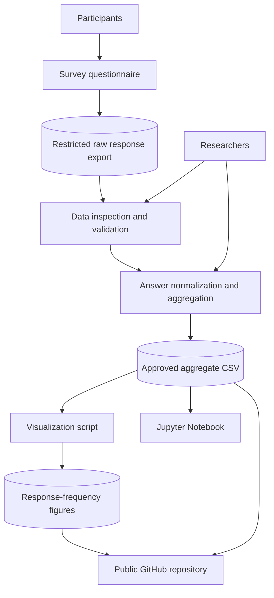

# Domain Model

## 1. System overview

The project analyzes participant classifications of 12 email examples in a survey. Participants choose one of two labels: `phishing` or `legitimate`. The research workflow transforms survey responses into aggregate response counts and visualizations.

The public repository contains code, documentation, a synthetic benchmark sample, and approved aggregate outputs. The original participant-level survey export is kept in restricted local storage. The correct category and source of each email stimulus must be independently documented before objective detection accuracy or AI-authorship claims are made.

A separate synthetic benchmark demonstrates metric calculation for hypothetical AI-generated phishing, human-written phishing, and legitimate emails. It is technically separate from the student survey.

## 2. Actors

| Actor | Responsibility |
|---|---|
| Participant | Reads each email example and submits a phishing or legitimate classification. |
| Researchers | Prepare the questionnaire, manage raw responses, validate data, perform analysis, and interpret results. |
| Survey platform | Collects questionnaire responses and provides an export for analysis. |
| Public repository users | Access code, documentation, and approved aggregate research outputs. |

## 3. System components

| Component | Responsibility | Data handled |
|---|---|---|
| Survey questionnaire | Presents the 12 email examples and response options | Email stimuli and participant choices |
| Restricted raw-data storage | Holds the original survey export | Participant-level records; may contain identifying data |
| Data inspection script | Checks structure, missing values, and duplicates | Local raw CSV |
| Survey processing script | Normalizes answers and creates aggregates | Local raw CSV and optional verified answer key |
| Processed aggregate dataset | Stores counts by email and response category | Aggregated totals |
| Visualization script | Creates response-frequency charts | Public aggregate CSV |
| Jupyter Notebook | Documents configurable analysis | Explicitly selected, approved dataset |
| GitHub repository | Stores public code and reviewed outputs | No raw identifiable participant-level responses |

## 4. Data flow

Raw participant-level data remain in restricted storage. Only reviewed aggregate outputs are published.

## 5. Data entities

### 5.1 Survey response

A local participant-level record may contain:

| Field | Description |
|---|---|
| `participant_id` | Pseudonymous participant identifier |
| `email_id` | Identifier of the email example |
| `predicted_label` | Participant's answer: `phishing` or `legitimate` |

Additional attributes should be included only when they were actually collected and are required for the approved analysis. The public aggregate dataset does not contain participant-level responses.

### 5.2 Email metadata

A validated metadata record for each email stimulus should contain:

| Field | Description |
|---|---|
| `email_id` | Unique email-example identifier |
| `true_label` | Independently verified class: `phishing` or `legitimate` |
| `email_source` | Documented origin or generation method |
| `verification_note` | Evidence or procedure used to verify the class and source |

Do not infer a source or ground-truth class from the participant response distribution. The answer key must be checked against the original email stimuli.

### 5.3 Aggregate response record

The public aggregate CSV contains `email_id`, `phishing`, `legitimate`, `total_responses`, and `phishing_percentage`. These fields support descriptive summaries but do not establish whether a participant's answer was correct.

## 6. Trust boundaries

### Boundary 1: Participant and survey platform

Participants submit answers through the questionnaire. Researchers must use appropriate access controls and provide the information and consent materials required by the institution.

### Boundary 2: Raw data and analysis environment

The raw export may contain personal information. It must be stored in a restricted location. Data should be validated and minimized before analysis or release.

### Boundary 3: Private analysis and public GitHub

The public repository must not contain raw participant-level responses, consent records, email addresses, tokens, passwords, or other secrets. Only reviewed aggregate data, code, and documentation should be published.

## 7. STRIDE threat analysis

| STRIDE category | Example threat | Potential impact | Mitigation |
|---|---|---|---|
| Spoofing | Duplicate or invalid survey submissions | Distorted response counts | Apply appropriate survey access settings and inspect duplicate records |
| Tampering | Unauthorized changes to raw or processed data | Incorrect findings | Keep protected backups, validate outputs, and track code changes with Git |
| Repudiation | Unclear history of analysis changes | Reduced auditability | Use version-controlled code and record data-processing versions |
| Information Disclosure | Raw participant data committed to GitHub | Privacy violation | Exclude raw data, review staged files, and publish only approved aggregates |
| Denial of Service | Survey or storage service unavailable | Interrupted collection or analysis | Maintain secure backups of research materials |
| Elevation of Privilege | Unauthorized access to restricted exports | Exposure or modification of data | Apply least-privilege permissions and protect account credentials |

## 8. Security and privacy controls

- Keep original survey exports outside the public repository.
- Use pseudonymous participant identifiers in the analysis environment.
- Do not commit consent records, email addresses, tokens, passwords, or raw exports.
- Inspect `git status` and staged changes before every commit.
- Publish only aggregate data reviewed for disclosure risk.
- Keep the answer key and stimulus provenance records access-controlled; publish them only when permitted and appropriate.
- Recompute derived results from approved inputs rather than manually editing metric files.

## 9. Residual risks

A sample of 27 participants may not represent a wider population. Aggregate data limit independent participant-level reanalysis. Incomplete or undocumented stimulus provenance prevents reliable attribution of results to AI-generated content. These limitations must remain visible in the paper and README until resolved using original records and a documented validation process.
