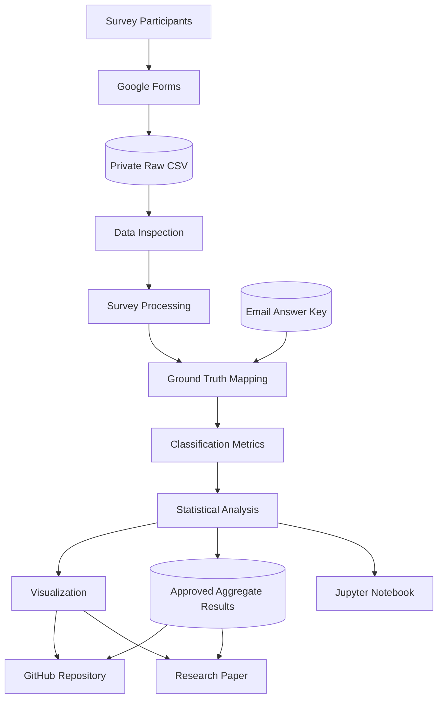

# Domain Model and STRIDE Threat Analysis

## 1. Project Overview

**Research title:** Human Ability to Detect AI-Generated Phishing Emails: A Review of Existing Research

**Authors:** Zhadyra Kurmanova and Meirim Yersultan

**Institution:** Narxoz University

This project examines human ability to identify phishing emails in the context of generative artificial intelligence.

The research workflow combines literature review, student survey collection, data processing, statistical analysis, and scientific visualization.

The system processes survey responses and compares participant classifications with a verified email answer key.

The project is a research data-processing pipeline and is not a production email security service.

## 2. System Actors

| Actor | Description | Responsibilities |
|---|---|---|
| Survey Participant | University student completing the questionnaire | Classifies email examples and provides survey information |
| Researcher | Member of the research team | Prepares survey materials, validates data, and analyzes results |
| Survey Platform | Google Forms | Collects questionnaire responses |
| Data Analyst | Researcher or authorized user running the analysis | Inspects, processes, and visualizes the data |
| Repository User | Authorized reader of the public GitHub project | Reviews documentation, code, and approved aggregate results |

## 3. Main System Components

| Component | Responsibility | Input | Output |
|---|---|---|---|
| Google Forms | Collect survey responses | Participant answers | Original survey export |
| Raw Data Storage | Stores original survey records securely | Google Forms CSV | Private CSV file |
| Data Inspection | Checks the input data | Raw CSV | Validation information |
| Survey Processing | Normalizes and transforms answers | Raw CSV | Long-format survey data |
| Email Answer Key | Stores verified classifications and authorship | Researcher-verified metadata | Ground-truth mapping |
| Metrics Module | Calculates classification performance | Participant predictions and ground truth | Statistical metrics |
| Visualization Module | Generates scientific figures | Aggregated results | PNG and PDF figures |
| Jupyter Notebook | Documents analysis steps | Approved input data | Reproducible analysis |
| GitHub Repository | Stores source code and documentation | Reviewed project artifacts | Public research repository |

## 4. System Data Flow

The research workflow follows these stages:

1. Participants complete the questionnaire.
2. Google Forms stores the submitted responses.
3. Researchers export the survey into a local CSV file.
4. The inspection module validates the file structure.
5. The processing module normalizes the Russian answer options.
6. The email answer key supplies the verified classification of each email.
7. Participant responses are compared with the ground-truth labels.
8. The metrics module calculates classification performance.
9. The visualization module creates research figures.
10. Approved aggregate outputs are published in the GitHub repository.

### 4.1. Data Flow Diagram



## 5. Research Data Model

### 5.1. Participant Data

The survey collects the following participant information:

| Variable | Type | Description |
|---|---|---|
| participant_id | String | Pseudonymous participant identifier |
| age_group | Categorical | Participant age category |
| cyber_knowledge | Categorical | Self-reported cybersecurity knowledge |
| phishing_experience | Categorical | Previous phishing experience |
| first_indicator | Categorical | First email characteristic checked |
| confidence | Numeric | Self-reported confidence, if provided |

The latest supplied response table contains 30 participant records. This count must be confirmed against the original export before publication.

### 5.2. Email Stimulus Data

Each email example has a unique identifier, a ground-truth class, and an authorship category.

| Email ID | Ground Truth | Authorship |
|---|---|---|
| email_01 | phishing | ai_generated |
| email_02 | legitimate | unknown |
| email_03 | phishing | human_written |
| email_04 | legitimate | unknown |
| email_05 | phishing | ai_generated |
| email_06 | legitimate | unknown |
| email_07 | phishing | human_written |
| email_08 | legitimate | unknown |
| email_09 | phishing | ai_generated |
| email_10 | legitimate | unknown |
| email_11 | phishing | human_written |
| email_12 | legitimate | unknown |

The authorship of legitimate emails is recorded as unknown because it has not been established.

The source category and ground-truth classification are stored as separate fields.

### 5.3. Classification Response Data

Each participant-email combination is represented by one observation.

| Variable | Type | Description |
|---|---|---|
| participant_id | String | Pseudonymous participant ID |
| email_id | String | Email example ID |
| predicted_label | Categorical | Participant classification |
| true_label | Categorical | Verified email classification |
| email_source | Categorical | Email authorship category |
| is_correct | Boolean | Whether the participant answer matches the ground truth |

The two possible classification values are:

- phishing
- legitimate

Missing answers are not automatically classified as correct or incorrect.

## 6. Trust Boundaries

The system contains three main trust boundaries.

### Boundary 1: Participants and Survey Platform

Participants submit information through Google Forms.

Potential risks include fraudulent submissions, duplicate submissions, and inaccurate responses.

### Boundary 2: Raw Data and Local Analysis Environment

The original CSV may contain personal or identifiable information.

Access to raw records must be restricted to authorized researchers.

### Boundary 3: Private Research Data and Public GitHub

The public repository must not contain:

- Original identifiable survey exports.
- Participant email addresses.
- Consent records.
- Private access credentials.
- Confidential research files.

Only reviewed aggregate results, source code, and approved documentation may be published.

## 7. STRIDE Threat Model

The STRIDE methodology is used to identify threats affecting the research data-processing workflow.

| STRIDE Category | Threat Scenario | Protected Component | Potential Impact | Mitigation |
|---|---|---|---|---|
| Spoofing | An unauthorized person submits responses while impersonating another participant | Google Forms | Invalid or duplicated survey responses | Restrict survey access where appropriate and inspect duplicate records |
| Tampering | A participant or unauthorized user modifies survey data or the email answer key | Raw CSV and Email Answer Key | Incorrect research results | Restrict file permissions, maintain protected backups, and validate input data |
| Repudiation | A researcher changes a dataset or analysis result without preserving a record of the change | Processing Scripts and Research Outputs | Reduced research accountability | Use Git commit history and preserve versioned analysis scripts |
| Information Disclosure | Private participant information is accidentally committed to GitHub | Raw Data Storage and Public Repository | Exposure of personal information | Apply `.gitignore`, inspect staged files, and publish only approved aggregate outputs |
| Denial of Service | A malformed or excessively large input file causes the processing pipeline to fail | Data Processing Module | Interrupted analysis | Validate file size and schema, handle exceptions, and test invalid inputs |
| Elevation of Privilege | An unauthorized user gains access to restricted research files or repository credentials | Local Storage and GitHub | Unauthorized access or modification | Use least-privilege access, protect credentials, and enable appropriate account security controls |

## 8. Security Controls

The following controls are included in the project workflow:

### 8.1. Data Validation

The processing module checks:

- Required columns.
- Valid answer categories.
- Missing responses.
- Duplicate participant-email records.
- Valid ground-truth labels.
- Consistent email identifiers.

### 8.2. Access Control

Original participant-level data are kept in restricted local storage.

Only authorized researchers should access the raw export.

### 8.3. Data Confidentiality

The public repository excludes original participant-level records and direct personal identifiers.

Participant identifiers used during processing are pseudonymous.

### 8.4. Integrity

The answer key is maintained separately from participant predictions.

Classification metrics are calculated from the verified answer key rather than manually entered participant scores.

Git version history supports review of code and documentation changes.

### 8.5. Reproducibility

The processing scripts and analysis notebook document how the results are generated.

Random seeds are fixed for bootstrap procedures.

Derived results should be regenerated from approved input data rather than manually edited.

## 9. Main Research Metrics

The analysis uses the following classification metrics:

| Metric | Description |
|---|---|
| Accuracy | Proportion of all correct classifications |
| Precision | Proportion of predicted phishing emails that are actually phishing |
| Recall | Proportion of actual phishing emails correctly detected |
| Specificity | Proportion of legitimate emails correctly identified |
| False Positive Rate | Proportion of legitimate emails incorrectly classified as phishing |
| F1-score | Harmonic mean of precision and recall |

The analysis also distinguishes AI-generated phishing recall from human-written phishing recall.

## 10. Residual Risks and Limitations

Several risks and limitations remain:

1. The participant sample is limited and should not be considered representative of all users.
2. Only three AI-generated and three human-written phishing examples are included.
3. The authorship of legitimate email examples is unknown.
4. Cybersecurity knowledge is self-reported.
5. Confidence responses are incomplete.
6. The processing workflow depends on the accuracy of the verified email answer key.
7. Publishing highly detailed aggregate results for very small groups may create disclosure risks.

The results should therefore be interpreted as observations from the selected survey stimuli and participant sample.

## 11. Conclusion

The domain model describes the main components, data flows, trust boundaries, and security risks of the phishing detection research workflow.

The STRIDE analysis identifies potential threats to survey collection, research data integrity, confidentiality, and reproducibility.

The proposed controls support responsible data handling and transparent research analysis.
```

### 3. Сохрани файл

Внизу GitHub нажми **Commit changes**.

Commit message:

```text
docs: improve domain model and STRIDE threat analysis
```

<badge color="success">Шаг 6 завершён</badge>

---

# Шаг 7. Создать `docs/data_dictionary.md`

Теперь создадим словарь данных. Он объясняет преподавателю, что означает каждая колонка в твоей таблице.

В папке `docs` нажми `Add file → Create new file`.

Название:

```text
data_dictionary.md
```

Вставь:

<CodeBlock language="markdown" editable>
# Data Dictionary

## 1. Overview

This document defines the variables used in the student phishing detection survey.

The original survey was created using Google Forms and contains demographic questions, email classification responses, and additional participant information.

## 2. Participant Variables

| Variable | Data Type | Description | Allowed Values |
|---|---|---|---|
| participant_id | String | Pseudonymous participant identifier | P001, P002, ... |
| age_group | Categorical | Participant age category | Under 18, 18–20, 21–23, 24 or older |
| cyber_knowledge | Categorical | Self-reported cybersecurity knowledge | Low, Medium, High |
| phishing_experience | Categorical | Previous phishing experience | Recognized immediately, Recognized later, No, Unsure |
| first_indicator | Categorical | First indicator checked by the participant | Sender address, Links and attachments, Urgency and threats, Personal or banking information, Grammar and writing style, Other |
| confidence | Integer | Self-reported confidence | 1–5, when provided |

## 3. Email Classification Variables

| Variable | Data Type | Description | Allowed Values |
|---|---|---|---|
| email_id | String | Unique email identifier | email_01–email_12 |
| predicted_label | Categorical | Participant's classification | phishing, legitimate |
| true_label | Categorical | Verified ground-truth class | phishing, legitimate |
| email_source | Categorical | Email authorship category | ai_generated, human_written, unknown |
| is_correct | Boolean | Whether the response matches the ground truth | True, False |

## 4. Email Groups

| Group | Email IDs | Number of Examples |
|---|---|---:|
| AI-generated phishing | 01, 05, 09 | 3 |
| Human-written phishing | 03, 07, 11 | 3 |
| Legitimate | 02, 04, 06, 08, 10, 12 | 6 |

## 5. Derived Metrics

| Metric | Formula |
|---|---|
| Accuracy | (TP + TN) / (TP + TN + FP + FN) |
| Precision | TP / (TP + FP) |
| Recall | TP / (TP + FN) |
| Specificity | TN / (TN + FP) |
| False Positive Rate | FP / (FP + TN) |
| F1-score | 2 × Precision × Recall / (Precision + Recall) |

## 6. Missing Values

Missing survey responses are represented as missing values rather than being replaced with assumed answers.

The confidence variable is incomplete in the currently supplied response table and must not be used for group-level statistical conclusions.

## 7. Privacy

The original timestamp column and direct identifying information are not required for the public aggregate analysis.

Participant-level records remain in restricted local storage.
