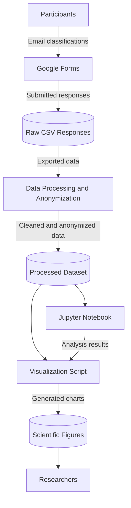

# Domain Model

## 1. System Overview

The project studies how accurately people can identify phishing emails, including AI-generated and human-written phishing messages.

The system consists of several stages:

1. Participants evaluate 12 email examples through an online questionnaire.
2. Responses are collected using Google Forms.
3. The collected responses are exported for data processing.
4. Raw data is cleaned, anonymized, and transformed into a structured dataset.
5. Python scripts and Jupyter Notebook are used for statistical analysis.
6. The results are presented through scientific visualizations and research reports.

The main purpose of the system is to support the analysis of human phishing detection performance while protecting participants' data and ensuring the integrity of research results.

## 2. System Actors

| Actor | Description |
|---|---|
| Participant | Evaluates email examples and submits classification responses. |
| Researchers | Manage the study, process collected data, perform statistical analysis, and interpret results. |
| Google Forms | External service used to collect questionnaire responses. |

## 3. System Components

| Component | Description |
|---|---|
| Google Forms | Collects participant responses. |
| Raw CSV Dataset | Stores exported questionnaire responses. |
| Data Processing Script | Cleans, anonymizes, and transforms the collected data. |
| Processed Dataset | Contains structured data prepared for analysis. |
| Jupyter Notebook | Performs exploratory and statistical analysis. |
| Visualization Script | Generates scientific charts and figures. |
| GitHub Repository | Stores source code, documentation, and approved research outputs. |

## 4. Data Flow Diagram (DFD)

The Data Flow Diagram illustrates how participant responses move through the research system, from data collection to statistical analysis and visualization.

The diagram represents the logical data flow of the research project. Raw participant responses should remain in restricted storage, while only approved anonymized or aggregated outputs may be used in public project materials.

## 5. Trust Boundaries

Trust boundaries separate system components with different levels of trust and access permissions.

### Boundary 1: Participants and Google Forms

Participants interact with an external online questionnaire platform. Submitted information is transmitted to Google Forms. The research team relies on the platform's access controls and secure communication.

### Boundary 2: Raw Data and Research Environment

Exported questionnaire responses enter the research environment. Raw data may contain sensitive information. Access should be restricted, and anonymization should be performed before data is used for analysis or publication.

### Boundary 3: Private Research Environment and Public GitHub

The research environment contains source files, datasets, and analysis outputs. The public GitHub repository should contain only approved source code, documentation, and anonymized or aggregated research outputs. Raw participant data must not be published.

These boundaries help identify where additional security controls are required.

## 6. STRIDE Threat Analysis

The STRIDE framework is used to identify potential security threats affecting the research system.

| STRIDE Category | Potential Threat | Affected Component | Potential Impact |
|---|---|---|---|
| Spoofing | Fake or duplicate participant submissions | Google Forms | Distorted research results |
| Tampering | Unauthorized modification of collected responses | Raw CSV / Processed Dataset | Incorrect statistical findings |
| Repudiation | Inability to trace changes to research files | Research Repository | Reduced accountability |
| Information Disclosure | Exposure of participant information | Raw Dataset / GitHub | Privacy violation |
| Denial of Service | Temporary unavailability of the questionnaire or stored data | Google Forms / Data Storage | Disruption of research |
| Elevation of Privilege | Unauthorized access to restricted research files | Data Storage / Research Environment | Unauthorized data access |

## 7. Security Controls and Mitigations

The following security controls are proposed to reduce the identified risks.

| Threat | Security Control | Purpose |
|---|---|---|
| Spoofing | Monitor duplicate submissions and apply appropriate form access restrictions | Reduce fraudulent or repeated submissions |
| Tampering | Keep protected raw-data backups and validate datasets before analysis | Preserve data integrity |
| Repudiation | Use Git commits and version history for project files | Track changes to source code and documentation |
| Information Disclosure | Anonymize participant data and exclude raw files using .gitignore | Protect participant privacy |
| Denial of Service | Maintain secure backups of research materials | Support recovery if data becomes unavailable |
| Elevation of Privilege | Apply least-privilege access and restrict permissions to sensitive files | Prevent unauthorized data access |

## 8. Data Privacy and Ethics

Participant data should be handled confidentially throughout the research process.

Raw questionnaire responses should be stored in a restricted environment. Personal identifiers should be removed or separated before analysis.

Only approved anonymized or aggregated data should be considered for public release.

The research team should verify the applicable consent procedures and institutional ethical requirements before using and publishing participant data.

## 9. Residual Risks

Some risks may remain even after security controls are applied.

For example, duplicate submissions may not always be detected, accidental data exposure may still occur, and external services may become unavailable.

Therefore, the research team should periodically review access permissions, validate research datasets, and maintain secure backups.
