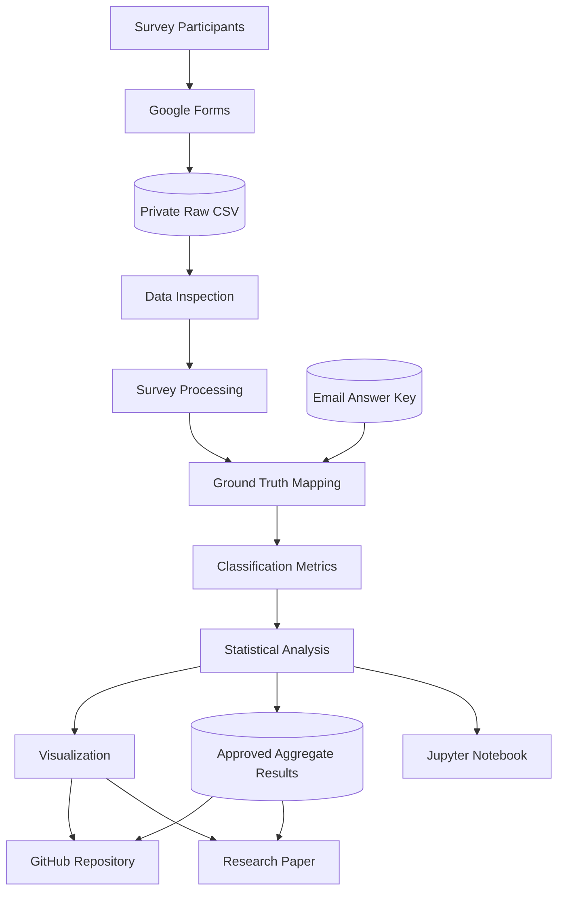

# Domain Model and STRIDE Threat Analysis

## 1. Project Overview

**Research title:** Human Ability to Detect AI-Generated Phishing Emails: A Review of Existing Research

**Authors:** Zhadyra Kurmanova and Meirim Yersultan

**Institution:** Narxoz University

This project examines human ability to identify phishing emails in the context of generative artificial intelligence.

The research workflow combines literature review, student survey collection, data processing, statistical analysis, and scientific visualization.

The system processes survey responses and compares participant classifications with a verified email answer key.

The project is a research data-processing pipeline and is not a production email security service.

## 2. System Actors

| Actor | Description | Responsibilities |
|---|---|---|
| Survey Participant | University student completing the questionnaire | Classifies email examples and provides survey information |
| Researcher | Member of the research team | Prepares survey materials, validates data, and analyzes results |
| Survey Platform | Google Forms | Collects questionnaire responses |
| Data Analyst | Researcher or authorized user running the analysis | Inspects, processes, and visualizes the data |
| Repository User | Authorized reader of the public GitHub project | Reviews documentation, code, and approved aggregate results |

## 3. Main System Components

| Component | Responsibility | Input | Output |
|---|---|---|---|
| Google Forms | Collect survey responses | Participant answers | Original survey export |
| Raw Data Storage | Stores original survey records securely | Google Forms CSV | Private CSV file |
| Data Inspection | Checks the input data | Raw CSV | Validation information |
| Survey Processing | Normalizes and transforms answers | Raw CSV | Long-format survey data |
| Email Answer Key | Stores verified classifications and authorship | Researcher-verified metadata | Ground-truth mapping |
| Metrics Module | Calculates classification performance | Participant predictions and ground truth | Statistical metrics |
| Visualization Module | Generates scientific figures | Aggregated results | PNG and PDF figures |
| Jupyter Notebook | Documents analysis steps | Approved input data | Reproducible analysis |
| GitHub Repository | Stores source code and documentation | Reviewed project artifacts | Public research repository |

## 4. System Data Flow

The research workflow follows these stages:

1. Participants complete the questionnaire.
2. Google Forms stores the submitted responses.
3. Researchers export the survey into a local CSV file.
4. The inspection module validates the file structure.
5. The processing module normalizes the Russian answer options.
6. The email answer key supplies the verified classification of each email.
7. Participant responses are compared with the ground-truth labels.
8. The metrics module calculates classification performance.
9. The visualization module creates research figures.
10. Approved aggregate outputs are published in the GitHub repository.

### 4.1. Data Flow Diagram

## 5. Research Data Model

### 5.1. Participant Data

The survey collects the following participant information:

| Variable | Type | Description |
|---|---|---|
| participant_id | String | Pseudonymous participant identifier |
| age_group | Categorical | Participant age category |
| cyber_knowledge | Categorical | Self-reported cybersecurity knowledge |
| phishing_experience | Categorical | Previous phishing experience |
| first_indicator | Categorical | First email characteristic checked |
| confidence | Numeric | Self-reported confidence, if provided |

The final number of valid participants must be verified against the original survey export and reported consistently across the methodology, results, and research paper.

### 5.2. Email Stimulus Data

Each email example has a unique identifier, a ground-truth class, and an authorship category.

| Email ID | Ground Truth | Authorship |
|---|---|---|
| email_01 | phishing | ai_generated |
| email_02 | legitimate | unknown |
| email_03 | phishing | human_written |
| email_04 | legitimate | unknown |
| email_05 | phishing | ai_generated |
| email_06 | legitimate | unknown |
| email_07 | phishing | human_written |
| email_08 | legitimate | unknown |
| email_09 | phishing | ai_generated |
| email_10 | legitimate | unknown |
| email_11 | phishing | human_written |
| email_12 | legitimate | unknown |

The authorship of legitimate emails is recorded as unknown because it has not been established.

The source category and ground-truth classification are stored as separate fields.

### 5.3. Classification Response Data

Each participant-email combination is represented by one observation.

| Variable | Type | Description |
|---|---|---|
| participant_id | String | Pseudonymous participant ID |
| email_id | String | Email example ID |
| predicted_label | Categorical | Participant classification |
| true_label | Categorical | Verified email classification |
| email_source | Categorical | Email authorship category |
| is_correct | Boolean | Whether the participant answer matches the ground truth |

The two possible classification values are:

- phishing
- legitimate

Missing answers are not automatically classified as correct or incorrect.

## 6. Trust Boundaries

The system contains three main trust boundaries.

### Boundary 1: Participants and Survey Platform

Participants submit information through Google Forms.

Potential risks include fraudulent submissions, duplicate submissions, and inaccurate responses.

### Boundary 2: Raw Data and Local Analysis Environment

The original CSV may contain personal or identifiable information.

Access to raw records must be restricted to authorized researchers.

### Boundary 3: Private Research Data and Public GitHub

The public repository must not contain:

- Original identifiable survey exports.
- Participant email addresses.
- Consent records.
- Private access credentials.
- Confidential research files.

Only reviewed aggregate results, source code, and approved documentation may be published.

## 7. STRIDE Threat Matrix

The STRIDE threat model identifies potential security threats affecting the research data collection and analysis workflow.

STRIDE consists of six categories: Spoofing, Tampering, Repudiation, Information Disclosure, Denial of Service, and Elevation of Privilege.

| STRIDE Category | Protected Component | Potential Threat | Impact | Mitigation |
|---|---|---|---|---|
| Spoofing | Google Forms | A person submits responses while pretending to be another participant | Duplicate or fraudulent responses may affect research results | Check duplicate submissions and review suspicious response patterns |
| Tampering | Raw CSV and Email Answer Key | Survey responses or correct labels are modified without authorization | Incorrect classification metrics and unreliable conclusions | Restrict file access, validate data, and maintain version history |
| Repudiation | Data Processing Workflow | Changes to research files cannot be traced to an authorized researcher | Difficulty verifying the origin of modifications | Use Git commit history and document data processing decisions |
| Information Disclosure | Raw Survey Data | Participant-level information is accidentally published in the public repository | Loss of confidentiality and potential privacy violations | Keep raw participant data private and publish only reviewed aggregate results |
| Denial of Service | Google Forms and Analysis Environment | Excessive submissions or unavailable services interrupt data collection or processing | Delayed research and incomplete datasets | Maintain authorized backups and validate the completeness of exported data |
| Elevation of Privilege | Research Storage and GitHub Repository | An unauthorized user obtains access to restricted research files or repository settings | Unauthorized modification or disclosure of research data | Apply least-privilege access, protect accounts, and review repository permissions |

### 7.1. Protected Assets

The main protected assets are:

- Participant survey responses.
- Original CSV exports.
- Verified email answer key.
- Data processing scripts.
- Statistical results and scientific figures.
- Research documentation and repository integrity.

### 7.2. Threat Prioritization

The most important threats for this research are:

1. **Information Disclosure:** Accidental publication of participant-level survey data.
2. **Tampering:** Unauthorized modification of the answer key or participant responses.
3. **Spoofing:** Fraudulent or duplicate survey submissions affecting the validity of results.

These threats directly affect participant privacy, data integrity, and the reliability of the research conclusions.

### 7.3. Security Considerations

The research team should restrict access to original survey exports, validate input data, maintain a separate verified answer key, and review files before publication.

The proposed mitigations describe security measures that should be applied. Their presence in this document does not by itself confirm that every measure has been implemented.

## 8. Security Controls

The following controls are included in the project workflow:

### 8.1. Data Validation

The processing module checks:

- Required columns.
- Valid answer categories.
- Missing responses.
- Duplicate participant-email records.
- Valid ground-truth labels.
- Consistent email identifiers.

### 8.2. Access Control

Original participant-level data are kept in restricted local storage.

Only authorized researchers should access the raw export.

### 8.3. Data Confidentiality

The public repository excludes original participant-level records and direct personal identifiers.

Participant identifiers used during processing are pseudonymous.

### 8.4. Integrity

The answer key is maintained separately from participant predictions.

Classification metrics are calculated from the verified answer key rather than manually entered participant scores.

Git version history supports review of code and documentation changes.

### 8.5. Reproducibility

The processing scripts and analysis notebook document how the results are generated.

Random seeds are fixed for bootstrap procedures.

Derived results should be regenerated from approved input data rather than manually edited.

## 9. Main Research Metrics

The analysis uses the following classification metrics:

| Metric | Description |
|---|---|
| Accuracy | Proportion of all correct classifications |
| Precision | Proportion of predicted phishing emails that are actually phishing |
| Recall | Proportion of actual phishing emails correctly detected |
| Specificity | Proportion of legitimate emails correctly identified |
| False Positive Rate | Proportion of legitimate emails incorrectly classified as phishing |
| F1-score | Harmonic mean of precision and recall |

The analysis also distinguishes AI-generated phishing recall from human-written phishing recall.

## 10. Residual Risks and Limitations

Several risks and limitations remain:

1. The participant sample is limited and should not be considered representative of all users.
2. Only three AI-generated and three human-written phishing examples are included.
3. The authorship of legitimate email examples is unknown.
4. Cybersecurity knowledge is self-reported.
5. Confidence responses are incomplete.
6. The processing workflow depends on the accuracy of the verified email answer key.
7. Publishing highly detailed aggregate results for very small groups may create disclosure risks.

The results should therefore be interpreted as observations from the selected survey stimuli and participant sample.

## 11. Conclusion

The domain model describes the main components, data flows, trust boundaries, and security risks of the phishing detection research workflow.

The STRIDE analysis identifies potential threats to survey collection, research data integrity, confidentiality, and reproducibility.

The proposed controls support responsible data handling and transparent research analysis. 
